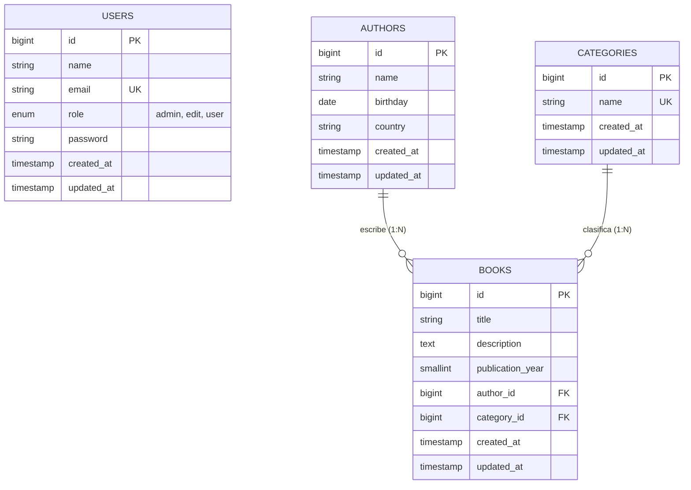

<p align="center">
  <a href="https://laravel.com" target="_blank">
    
  </a>
</p>

<h1 align="center">📚 Sistema de Gestión de Libros — Laravel 12</h1>

<p align="center">
  
  
  
  
</p>

Aplicación web desarrollada con **Laravel 12 (versión actual y estable)** para la administración de un catálogo bibliográfico que permite gestionar **Autores**, **Categorías** y **Libros**, integrando autenticación de usuarios con **Laravel Breeze**, validación mediante `FormRequest`, integridad referencial en base de datos y control de acciones según el **rol del usuario** (`admin`, `edit`, `user`).

---

## 📋 Tabla de Contenidos

1. [¿Cómo funciona el sistema?](#-cómo-funciona-el-sistema)
2. [Arquitectura y Base de Datos](#-arquitectura-y-base-de-datos)
3. [Roles de Usuario y Permisos](#-roles-de-usuario-y-permisos)
4. [Requisitos Previos (Laravel 12)](#-requisitos-previos-laravel-12)
5. [Guía Paso a Paso: Instalación al descargar desde GitHub](#-guía-paso-a-paso-instalación-al-descargar-desde-github)
6. [Credenciales de Prueba (Seeders)](#-credenciales-de-prueba-seeders)
7. [Rutas Principales del Sistema](#-rutas-principales-del-sistema)
8. [Comandos Útiles de Desarrollo](#-comandos-útiles-de-desarrollo)

---

## ⚙️ ¿Cómo funciona el sistema?

El sistema está protegido mediante autenticación (`middleware('auth')`). Una vez que el usuario se registra o inicia sesión, accede a la barra de navegación principal con cuatro secciones clave:

### 1. Autenticación y Perfil (`Laravel Breeze`)
- Registro de nuevos usuarios (`/register`), inicio de sesión (`/login`), recuperación de contraseña y verificación de correo.
- Gestión del perfil de usuario (`/profile`): actualización de nombre/correo, cambio de contraseña y eliminación de la cuenta.

### 2. Módulo de Autores (`/authors`)
Administrado por `AuthorController` y el modelo `Author`:
- **Listar (`index`)**: Muestra la tabla de autores registrados con su nombre, país y fecha de nacimiento.
- **Crear (`create` / `store`)**: Formulario validado por `StoreAuthorRequest`:
  - `name`: obligatorio, texto, entre `3` y `15` caracteres.
  - `birthday`: fecha válida (`YYYY-MM-DD`, opcional en BD).
  - `country`: texto, entre `3` y `20` caracteres.
- **Ver detalle (`show`)**, **Editar (`edit` / `update`)** y **Eliminar (`destroy`)**.

### 3. Módulo de Categorías (`/categories`)
Administrado por `CategoryController` y el modelo `Category`:
- **Listar (`index`)**: Muestra todas las categorías literarias disponibles (ej. *Novela*, *Drama*, *Filosofía*).
- **Crear (`create` / `store`)**: Formulario validado por `StoreCategoryRequest`:
  - `name`: obligatorio, texto único en la tabla `categories`, entre `3` y `20` caracteres.
- **Ver detalle (`show`)**, **Editar (`edit` / `update`)** y **Eliminar (`destroy`)**.

### 4. Módulo de Libros (`/books`)
Administrado por `BookController` y el modelo `Book`:
- **Listar (`index`)**: Muestra el catálogo de libros indicando su título, año de publicación, nombre del autor (`$book->author->name`), categoría (`$book->category->name`) y descripción.
- **Crear (`create` / `store`)** y **Actualizar (`edit` / `update`)**: Carga dinámicamente los autores y categorías ordenados alfabéticamente y valida los datos mediante `StoreBookRequest`:
  - `title`: obligatorio, texto, entre `3` y `40` caracteres.
  - `author_id`: obligatorio, entero (ID del autor seleccionado).
  - `category_id`: obligatorio, entero (ID de la categoría seleccionada).
  - `publication_year`: obligatorio, entre `3` y `4` dígitos (ej. `1603`, `1967`).
  - `description`: texto descriptivo de hasta `200` caracteres.
- **Integridad Referencial**: Antes de registrar un libro debe existir al menos un **Autor** y una **Categoría**. Las llaves foráneas cuentan con `restrictOnDelete()`, lo que impide eliminar por accidente un autor o categoría que ya tenga libros asociados.

---

## 🗄️ Arquitectura y Base de Datos

El modelo de datos relaciona **Autores** (`1:N`) y **Categorías** (`1:N`) con la tabla central de **Libros**:



---

## 🔐 Roles de Usuario y Permisos

La tabla `users` incluye el campo `role` (`enum('admin', 'edit', 'user')` con valor por defecto `'user'`), el cual controla qué botones de acción se habilitan en las vistas:

| Rol | Ver Listado y Detalles (`index`/`show`) | Crear Registros (`create`) | Editar Registros (`edit`) | Eliminar Registros (`destroy`) |
| :--- | :---: | :---: | :---: | :---: |
| **`admin`** | ✅ Sí | ✅ Sí | ✅ Sí (Libros y Autores) | ✅ Sí (Todos los módulos) |
| **`edit`** | ✅ Sí | ✅ Sí | ✅ Sí (Libros, Autores y Categorías) | ❌ No |
| **`user`** *(por defecto)* | ✅ Sí | ✅ Sí | ❌ No | ❌ No |

---

## 💻 Requisitos Previos (Laravel 12)

Para ejecutar este proyecto en **Laravel 12 (versión actual y estable)** en tu entorno local (como **XAMPP**, **Laragon**, **Laravel Herd** o Linux/macOS), asegúrate de contar con:

- **PHP**: `>= 8.2` (recomendado PHP 8.2, 8.3 u 8.4) con las siguientes extensiones habilitadas en `php.ini`:
  - `ctype`, `curl`, `dom`, `fileinfo`, `filter`, `hash`, `mbstring`, `openssl`, `pcre`, `pdo`, `session`, `tokenizer`, `xml`
  - `pdo_sqlite` (si usas SQLite) o `pdo_mysql` (si usas MySQL/MariaDB en XAMPP).
- **Composer**: `>= 2.x` ([Descargar Composer](https://getcomposer.org/)).
- **Node.js y NPM**: `Node.js >= 18.x` (recomendado `>= 20.x` LTS) para compilar los estilos con Vite y Tailwind CSS ([Descargar Node.js](https://nodejs.org/)).
- **Git**: Para clonar el repositorio ([Descargar Git](https://git-scm.com/)).

---

## 🚀 Guía Paso a Paso: Instalación al descargar desde GitHub

Sigue estos pasos detallados en orden después de clonar o descargar el proyecto desde GitHub:

### Paso 1: Clonar el repositorio desde GitHub
Abre tu terminal (PowerShell, CMD o Git Bash) dentro de tu carpeta de proyectos (por ejemplo `C:\xampp\htdocs\laravel`) y ejecuta:

```bash
git clone <URL_DEL_REPOSITORIO_GITHUB> iGaming
cd iGaming
```
*(Si lo descargaste como archivo `.zip`, descomprímelo y abre la terminal dentro de la carpeta del proyecto).*

---

### Paso 2: Instalar las dependencias de PHP (Composer)
Descarga el núcleo de **Laravel 12** y todos los paquetes de backend definidos en `composer.json`:

```bash
composer install
```

---

### Paso 3: Instalar las dependencias de Frontend (NPM)
Instala Vite, Tailwind CSS y Alpine.js definidos en `package.json`:

```bash
npm install
```

---

### Paso 4: Configurar el archivo de variables de entorno (`.env`)
Copia el archivo de ejemplo `.env.example` para crear tu archivo `.env` local:

- **En Windows (CMD / PowerShell):**
  ```powershell
  copy .env.example .env
  ```
- **En Git Bash / Linux / macOS:**
  ```bash
  cp .env.example .env
  ```

Luego, genera la llave de cifrado única de la aplicación Laravel:

```bash
php artisan key:generate
```

---

### Paso 5: Configurar la Base de Datos
El proyecto soporta tanto **SQLite** (configuración inmediata por defecto en Laravel 12) como **MySQL / MariaDB** (XAMPP):

#### Opción A: Usar SQLite (Por defecto en `.env.example`)
1. Asegúrate de que en tu archivo `.env` esté definido:
   ```env
   DB_CONNECTION=sqlite
   ```
2. Crea el archivo vacío `database/database.sqlite` si aún no existe (o deja que `php artisan migrate` te pregunte si deseas crearlo):
   - **Windows PowerShell:**
     ```powershell
     New-Item -ItemType File -Path database/database.sqlite -Force
     ```
   - **Git Bash / Linux / macOS:**
     ```bash
     touch database/database.sqlite
     ```

#### Opción B: Usar MySQL / MariaDB con XAMPP
1. Inicia **Apache** y **MySQL** desde el Panel de Control de XAMPP y crea una base de datos vacía llamada `igaming` (por ejemplo, desde `http://localhost/phpmyadmin`).
2. Edita el archivo `.env` y actualiza el bloque de base de datos:
   ```env
   DB_CONNECTION=mysql
   DB_HOST=127.0.0.1
   DB_PORT=3306
   DB_DATABASE=igaming
   DB_USERNAME=root
   DB_PASSWORD=
   ```

---

### Paso 6: Ejecutar las Migraciones
Crea todas las tablas del sistema (`users`, `categories`, `authors`, `books`, `sessions`, `cache`, `jobs`) ejecutando:

```bash
php artisan migrate
```

---

### Paso 7: Poblar la Base de Datos con los Seeders (Datos de Prueba)
El proyecto incluye Seeders para usuarios con distintos roles, autores clásicos, categorías y libros. Ejecútalos en el siguiente orden para respetar las llaves foráneas:

```bash
php artisan db:seed --class=UserSeeder
php artisan db:seed --class=AuthorSeeder
php artisan db:seed --class=CategorySeeder
php artisan db:seed --class=BookSeeder
```

---

### Paso 8: Compilar Assets e Iniciar el Servidor

Tienes **dos formas** de levantar la aplicación en Laravel 12:

#### Forma 1: Comando unificado de desarrollo de Laravel 12 (Recomendado)
Levanta simultáneamente el servidor PHP (`artisan serve`), el procesador de colas, los logs en tiempo real (`pail`) y el servidor de Vite:

```bash
composer run dev
```

#### Forma 2: Ejecución tradicional en dos terminales
- **Terminal 1 (Compilación de estilos con Vite):**
  ```bash
  npm run dev
  ```
  *(O ejecuta `npm run build` si solo deseas compilar los archivos estáticos una vez).*

- **Terminal 2 (Servidor web de Laravel):**
  ```bash
  php artisan serve
  ```

Finalmente, abre tu navegador en:
👉 **[http://127.0.0.1:8000](http://127.0.0.1:8000)**

> 💡 **Atajo de instalación rápida en Laravel 12:**
> El archivo `composer.json` incluye el script `setup`. Si acabas de clonar el repositorio y deseas usar la configuración por defecto, puedes ejecutar `composer run setup` para instalar dependencias de Composer/NPM, crear el `.env`, generar la `APP_KEY`, correr migraciones y compilar el frontend en un solo paso.

---

## 👤 Credenciales de Prueba (Seeders)

Una vez ejecutado `php artisan db:seed --class=UserSeeder`, puedes iniciar sesión en `http://127.0.0.1:8000/login` con cualquiera de las siguientes cuentas para probar los distintos niveles de permisos:

| Rol | Correo Electrónico | Contraseña | Permisos en la Interfaz |
| :--- | :--- | :--- | :--- |
| **Administrador (`admin`)** | `admin@example.com` | `password` | Ver, Crear, Editar y **Eliminar** |
| **Editor (`edit`)** | `edit@example.com` | `password` | Ver, Crear y **Editar** |
| **Usuario Regular (`user`)** | `user@example.com` | `password` | Solo Ver y Crear |

Además, los seeders `AuthorSeeder`, `CategorySeeder` y `BookSeeder` cargan automáticamente:
- **Autores**: *Gabriel García Márquez*, *William Shakespeare*, *Jostein Gaarder*.
- **Categorías**: *Novela*, *Drama*, *Filosofía*.
- **Libros**: *Cien años de soledad (1967)*, *Hamlet (1603)*, *El mundo de Sofía (1991)*.

---

## 🧭 Rutas Principales del Sistema

Todas las rutas de gestión requieren haber iniciado sesión (`middleware('auth')`):

| Módulo | Método HTTP | URI | Nombre de Ruta | Controlador / Acción |
| :--- | :---: | :--- | :--- | :--- |
| **Inicio** | `GET` | `/` | — | Vista `welcome` |
| **Dashboard** | `GET` | `/dashboard` | `dashboard` | Panel principal post-login |
| **Autores** | `RESOURCE` | `/authors` | `authors.*` | `AuthorController` (`index`, `create`, `store`, `show`, `edit`, `update`, `destroy`) |
| **Categorías** | `RESOURCE` | `/categories` | `categories.*` | `CategoryController` (`index`, `create`, `store`, `show`, `edit`, `update`, `destroy`) |
| **Libros** | `RESOURCE` | `/books` | `books.*` | `BookController` (`index`, `create`, `store`, `show`, `edit`, `update`, `destroy`) |
| **Perfil** | `GET/PATCH/DELETE` | `/profile` | `profile.*` | `ProfileController` (`edit`, `update`, `destroy`) |

---

## 🛠️ Comandos Útiles de Desarrollo

```bash
# Limpiar caché de configuración, rutas y vistas
php artisan optimize:clear

# Ver el listado completo de rutas registradas
php artisan route:list

# Ejecutar la suite de pruebas automatizadas (Pest / PHPUnit)
composer run test

# Formatear el código PHP siguiendo el estándar de Laravel (Pint)
./vendor/bin/pint
```

---

## 📄 Licencia

Este proyecto está desarrollado sobre el framework [Laravel 12](https://laravel.com), distribuido bajo la licencia de código abierto [MIT](https://opensource.org/licenses/MIT).
